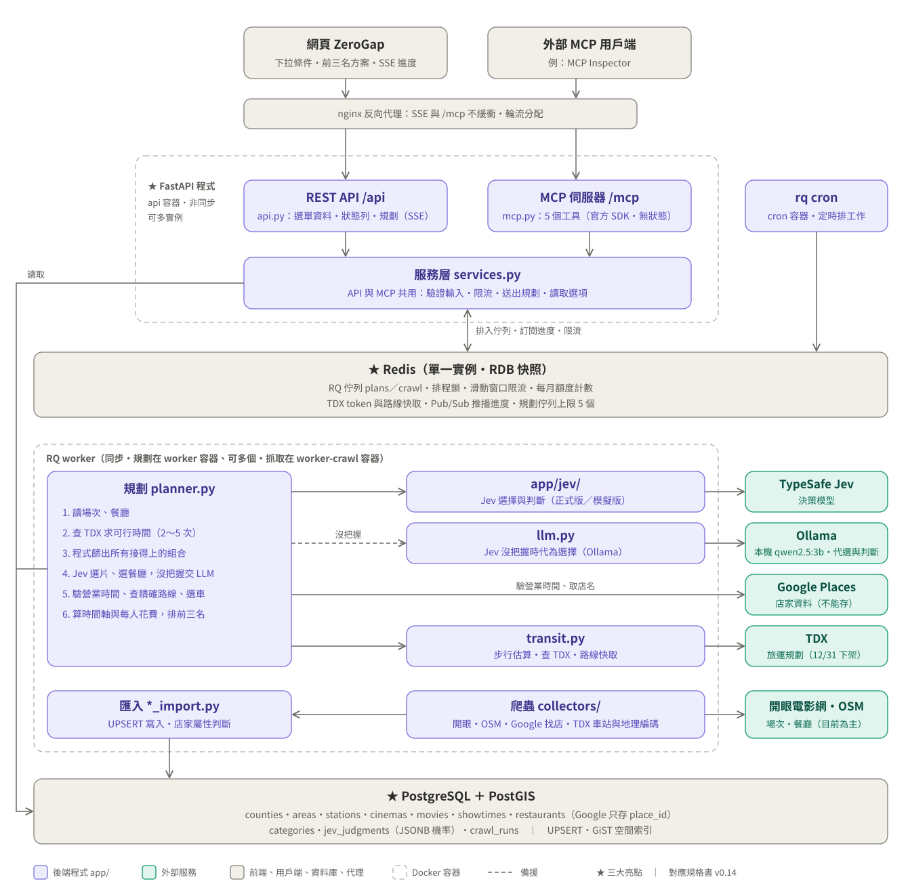

# ZeroGap 零空檔：後端規格書

| 項目 | 內容 |
|---|---|
| 版本 | v0.12（逐項確認實作時新增的預設值：早到 30 分鐘內等開門、餐廳備選補滿 2 家、沒判斷屬性的店不排、Jev 沒把握就附備選、新增 `restaurant.hours_verified`。v0.11：實作中的補充列在 10.1；`restaurants.source` 新增 `demo`；修正 5.3 路線快取的取整範例；7.3 補上價位區間的代碼；實作時的小調整：`areas.sort_order`、`area_hubs.geom` 可以是 null、migration 一併寫入類別和票價。v0.10：補上前端對照時發現的缺口：下拉選單的回應範例、跨午夜的判斷、`reasons` 的 key、排隊順位的意思、備選欄位、OSM 出處。v0.9：備選只附估計值、第一名固定「最推薦」、回程緩衝加 `return_window`。v0.8 起前端 ZeroGap 照這份規格串接、飲食限制延後；架構與 v0.4 相同） |
| 日期 | 2026-10-20 |
| 狀態 | 草稿 |
| 討論紀錄 | [spec-discussion.md](spec-discussion.md) |

**標記說明**
- **【預設】**：為了趕進度先採用的預設值，可以調整。
- **【待提供】**：資料要由團隊提供。
- **【實作前確認】**：開始寫程式前要再查證。

---

## 0. 給組員的審閱重點

這份是**草稿**。架構和主要設計已經逐項討論決定；標「預設」的地方是為了趕進度先填的值，歡迎提出修改。回饋時請註明**章節編號**和建議的做法或數字。

### 請優先確認

| 主題 | 看哪裡 | 要確認的事 |
|---|---|---|
| 前端串接 | 6.2～6.5、6.7 | 前端 ZeroGap 改照這份規格串接：端點、請求欄位、SSE 的讀法、結果格式是否夠前端用 |
| 方案特色標籤 | 6.5 | 第一名固定「最推薦」；第二、三名的分配規則是預設值 |
| 時間規則 | 7.1 步驟 3 | 開演前 15 分鐘到場、候位 10 分鐘、用餐時間 45／75／105 分鐘、最後點餐是打烊前 30 分鐘、步行速度，這些數字是否合理 |
| Jev 的用法 | 3.1、7.1 步驟 4、7.3 | Jev 要回答哪些題目；「最高機率低於 60%」才交給 LLM 的門檻 |
| 資料 | 4.3 | 料理類別的說明、片型主清單、票價參考、四個商圈的代表點 |
| 速度與額度 | 5.5、7.1、9 | 一次規劃約 2～3 分鐘、多人時要排隊；Google 每月約 190～310 次規劃後改用 OSM，能不能接受；Jev 選項多時常常沒把握，會很常出現 LLM 代選 |

### 已經決定、不建議再改的

除非有新資訊，以下項目已經定案：
- 三大技術：FastAPI、PostgreSQL（只用 PostgreSQL，不用 SQLite）、Redis。
- 任務佇列用 RQ；Redis 只開一個。
- 規劃結果用 SSE 推送，而且不保存。
- MCP 用無狀態模式，不用 sampling，依 MCP 2026-07-28 版規範。
- Google 的店家資料只存 `place_id`，依 Google 的條款。
- 交通即時查詢 TDX 旅運規劃 API。
- 前端 ZeroGap 照這份規格串接，不照它原本依據的 `docs/API.md`（2026-10-20 決定）。
- 飲食限制（素食、不吃牛、過敏原）這一版不做，原本的設計放在附錄 A。

### 這份文件沒有涵蓋的

- 前端的畫面設計
- 部署在哪台主機、用什麼網域
- 組員分工與時程
- 監控儀表板

---

## 1. 概述

### 1.1 目的

使用者用下拉選單選好出發站、約會商圈、日期、最早出門和最晚到家的時間，以及電影、餐點、預算等條件。系統會排出**前三名方案**，每個方案包含：
- 看哪部片、吃哪一家、搭什麼車
- 每一段從幾點到幾點的時間軸
- 每人大約花多少、幾點到家

### 1.2 功能範圍

- **約會範圍**：在單一商圈內規劃。目前開放桃園市 4 個商圈：桃園區、中壢、青埔、八德。
- **出發地**：可以從**任何縣市**的軌道車站出發，「到家」的意思是回到出發站。
- **分工**：
  - 程式負責：檢查時間、轉乘、末班車、營業時間、每人預算是否都接得上，並計算所有時間和金額。
  - TypeSafe Jev 只負責「選」：看哪部片、吃哪一家、去程和回程搭哪一條路線。
- **Jev 沒把握時**：最高機率低於 60%，先交給 LLM 選一個，同時列出其他選項，讓使用者可以自己改選。
- **交通**：用 TDX 旅運規劃 API 查詢，包含捷運、台鐵、高鐵、公車、輕軌；影城和餐廳之間的距離用步行估算。
- **推送**：規劃進度和結果用 SSE 即時推送。
- **MCP**：提供 MCP 介面，讓外部的 AI 客戶端呼叫。
- **資料更新**：每天自動更新場次和餐廳資料。

### 1.3 不在範圍內

- 使用者帳號、登入、權限
- 保存規劃紀錄
- 自然語言輸入（例如聊天機器人）
- 訂票、訂位
- 跨商圈的約會：電影和餐廳一定在同一個商圈，但出發站可以在其他縣市
- 飲食限制（素食、不吃牛、過敏原）：這一版先不做，設計保留在附錄 A

### 1.4 技術亮點

| 技術 | 用法 |
|---|---|
| **FastAPI** | 非同步 API；POST 直接回傳 SSE 串流推送規劃進度；用官方 MCP SDK 手寫 MCP 工具，跟 REST API 共用服務層，同一個程式提供網頁和 AI 客戶端兩種介面；MCP 依 2026-07-28 版規範以無狀態模式運作，並支援進度通知 |
| **PostgreSQL** | PostGIS 依使用者的步行上限，篩出影城附近的餐廳，幫上千種組合算步行時間；JSONB 存 Jev 的機率分布；UPSERT 讓每天重抓資料不會重複；CHECK 約束確保不違反 Google 的資料保存條款 |
| **Redis** | 用 RQ 做任務佇列；分散式排程鎖；滑動窗口限流；每月額度計數；外部 API 的 token 和路線快取；Pub/Sub 跨實例推播進度 |

---

## 2. 系統架構

### 2.1 架構圖



- 虛線框是 Docker 容器：FastAPI（`api`）和 RQ worker（`worker`）都可以開多個實例。
- 標 ★ 的是三大亮點：FastAPI、Redis、PostgreSQL。
- 虛線箭頭是備援：Jev 沒把握時交給 `llm.py`，由它呼叫 Ollama。
- 架構從 v0.4 起沒有變動，所以檔名沿用 v0.4；圖上的文字已更新到 v0.8（拿掉飲食限制、前端改名 ZeroGap、TDX 可行時間 2～5 次）。原始檔：[architecture-v0.4.svg](架構圖/architecture-v0.4.svg)。要修改時直接編輯這個 SVG 檔，再轉一次 PNG：[architecture-v0.4.png](架構圖/architecture-v0.4.png)。

### 2.2 元件說明

| 元件 | 位置 | 職責 |
|---|---|---|
| REST API | `app/api.py` | 驗證輸入、限流、送出規劃並推送 SSE、提供下拉選單資料和狀態列 |
| MCP | `app/mcp.py` | 用官方 MCP Python SDK 手寫 5 個工具，直接呼叫 `services.py`，掛在 `/mcp`；以無狀態模式運作，負責進度通知 |
| 服務層 | `app/services.py` | API 和 MCP 共用：組查詢條件、讀資料、送出規劃工作 |
| 規劃 | `app/planner.py` | 在 worker 中執行：求可行時間、篩組合、請 Jev 選、驗證營業時間、查精確路線、算時間軸與花費 |
| 交通 | `app/transit.py` | 步行估算、呼叫 TDX、路線快取 |
| Jev | `app/jev/` | 包裝 TypeSafe Jev；另有測試用的模擬版 |
| LLM 備援 | `app/llm.py` | Jev 沒把握時，請 Ollama 從前幾名中選一個 |
| 爬蟲 | `app/collectors/` | 開眼電影網、Google Places、OSM、TDX 軌道車站、TDX 地理編碼 |
| 匯入 | `app/ingest.py` | UPSERT 寫入、Jev 預判；也可以用 `python -m app.ingest` 手動執行 |
| 背景工作 | `app/jobs/` | RQ 的工作函式、`rq cron` 的設定 |
| 共用元件 | `app/redis_utils/` | 鎖、限流、額度計數、快取 |

### 2.3 專案目錄【預設】

```
app/
  main.py          # FastAPI 進入點，掛載 /api 和 /mcp
  api.py  mcp.py  services.py  planner.py  transit.py  llm.py  ingest.py
  config.py        # 讀取環境變數
  db.py            # SQLAlchemy engine 和 session（非同步、同步各一）
  models/          # SQLAlchemy 模型
  schemas/         # Pydantic 的請求和回應格式
  jev/             # client.py（正式版）、mock.py（模擬版）
  collectors/      # atmovies.py、google_places.py、osm.py、tdx_stations.py、tdx_geocode.py
  jobs/            # plan_job.py、refresh_job.py、cron_config.py
  redis_utils/     # lock.py、ratelimit.py、quota.py、cache.py
migrations/        # Alembic
tests/
docker-compose.yml
.env.example
```

---

## 3. 外部服務

| 服務 | 用途 | 認證 | 限制（自家設定） | 碰到限制時 |
|---|---|---|---|---|
| **TypeSafe Jev** | 寫入時判斷店家和電影的屬性；規劃時選片、選餐廳、選路線 | API 金鑰 | 每分鐘 300 次；每月費用 1 美元 | 排隊等候；每月費用用完就全部交給 LLM |
| **TDX 旅運規劃** | 查路線、時間、車資 | OAuth2（token 1 天過期） | 每分鐘 5 次（所有 TDX API 共用）；不扣點 | 排隊等候，顯示順位 |
| **TDX 軌道車站** | 出發站清單（台鐵、高鐵、捷運、輕軌） | 同上 | 基礎服務，每次扣 2 單位；每週更新 | 暫停更新 |
| **TDX 地理編碼** | 影城的地址轉座標 | 同上 | 進階服務，每次扣 15 單位 | 暫停地理編碼 |
| **Google Places** | 寫入時找餐廳；規劃時補店家資料並驗證營業時間；座標超過 25 天就更新（條款上限 30 天） | API 金鑰 | 各 SKU 依每月免費額度留 5% 邊際（見 3.3） | 規劃用的額度用完就改用 OSM 備案 |
| **OSM**（Overpass API）【預設】 | 備案用的餐廳資料 | 無 | 顯示時要署名 OpenStreetMap（見 6.7） | — |
| **開眼電影網** | 影城、電影、場次 | 無（爬蟲） | 每天 1 次 | — |
| **Ollama** | Jev 沒把握時代為選擇：網頁、MCP、寫入時都用它 | 無（內部） | — | 逾時時：一律採用 Jev 機率最高的選項 |

### 3.1 TypeSafe Jev

- 端點：`POST https://api.typesafe.ai/v1/systemone`，模型 `jev-latest`。Python SDK 是 `typesafe-sdk`。
- 題型只用 `choice` 和 `score`。
- **沒把握的判斷標準**：**最高機率低於 0.6**，照簡報的規則。
  - 回應裡的信心值（confidence）只記錄、不用來判斷。
  - 這條規則同時適用於寫入時的判斷和規劃時的選擇。
- 每次判斷都記下回應裡的模型版本。版本改變時，寫入時的判斷全部重算。
- 一次請求可以同時問好幾題，每次規劃通常只要呼叫 2 次 Jev；換下一組時會再多 1～2 次（見 7.1）。

### 3.2 TDX 旅運規劃 API

- 端點：`GET https://tdx.transportdata.tw/api/maas/routing`
- 固定參數【預設】：
  - `transit=3,4,5,6,7`：高鐵、台鐵、公車、捷運、輕軌
  - `gc=1.0`：偏好最快
  - `first_mile_mode=0`、`last_mile_mode=0`：頭尾都走路
- 兩種用法：

  | 用途 | 時間參數 | `top` |
  |---|---|---|
  | 求可行時間 | 去程用 `depart`＝最早出門；回程用 `arrival`＝最晚到家 | 1 |
  | 前三名的精確路線 | 去程用 `arrival`＝需要抵達的時間；回程用 `depart`＝離開的時間 | 3，讓 Jev 選一條 |

- **檢查回傳時間**：時間參數不能是過去。查不到路線時 TDX 會自動放寬時間，所以程式**必須檢查**：
  - 用 `depart` 時，回傳的出發時間不能早於要求的時間。
  - 用 `arrival` 時，回傳的抵達時間不能晚於要求的時間。
- 班次名稱和車資從回傳的 `sections` 整理。這部分規格沒寫，【實作前確認】。

### 3.3 Google Places API (New)

| 用途 | API | 欄位（field mask） | SKU | 每月免費 | 自家上限 |
|---|---|---|---|---|---|
| 寫入時找餐廳（每週） | Nearby Search | `id`、`displayName`、`types`、`primaryType`、`formattedAddress`、`location`、`priceLevel` | Enterprise | 1,000 | 950 |
| 規劃時補前三名的店家資料，並驗證營業時間 | Place Details | `displayName`、`formattedAddress`、`regularOpeningHours`、`priceLevel` | Enterprise | 1,000 | **950** |
| 規劃時顯示備選餐廳的名稱 | Place Details | `displayName`、`formattedAddress` | Pro | 5,000 | 4,750 |
| 座標超過 25 天就更新（條款上限 30 天） | Place Details | `location` | Essentials | 10,000 | 9,500 |

- 寫入時要 `priceLevel`，是為了讓 Jev 判斷價位區間，所以 Nearby Search 會以 Enterprise 計費。
- **條款限制**：只能長期保存 `place_id`；座標最多保存 30 天；其他內容不能存進 PostgreSQL 或 Redis。Jev 需要的店名等資料只放在記憶體裡。顯示時要附 Google 標誌，由前端負責。
- **顯示規則**（2026-10-20 查證 Places 條款）：
  - 沒有搭配 Google 地圖顯示時，要附 Google 標誌。
  - Places 的資料如果要畫在地圖上，那張地圖必須是 Google 地圖。
  - 所以規劃結果中，Google 來源的餐廳只回傳 `place_id`、不回傳座標。前端用 Google 地圖網址的 `destination_place_id` 開啟，不需要金鑰（見 6.7）。

### 3.4 TDX 地理編碼

已從 TDX 線上 API 說明查證，屬於進階服務中的「空間查詢-定位 v3」，每點可呼叫 200 次。
- **地址轉座標**：`GET https://tdx.transportdata.tw/api/advanced/V3/Map/GeoCode/Coordinate/Address/{Address}?$format=JSON`
  - 回傳陣列，每筆有 `Address` 和 `Geometry` 兩個欄位。
- **地標名稱轉座標**：`GET .../V3/Map/GeoCode/Coordinate/Markname/{Markname}`。可以用來取得商圈代表點的座標。
- **注意**：
  - 另一個名為「輔助工具-地理編碼轉換」的 API 只能轉換 OpenLR 代碼，**不能**把地址轉成座標，不要用錯。
  - `Geometry` 的格式規格裡沒寫，要用金鑰實測一次。

### 3.5 TDX 軌道車站

- 屬於基礎服務的「公共運輸-軌道 v2」，伺服器是 `https://tdx.transportdata.tw/api/basic`。
- 端點：
  - 高鐵：`/v2/Rail/THSR/Station`
  - 捷運與輕軌：`/v2/Rail/Metro/Station/{RailSystem}`。`RailSystem` 可以是 TRTC、KRTC、TYMC、KLRT、NTDLRT、TMRT、NTMC、NTALRT。貓空纜車 TRTCMG 不收。
  - 台鐵：在同一份規格中，確切路徑【實作前確認】。
- 官方說明提到車站資料包含座標、站名、地址、縣市代碼，但欄位名稱【實作前確認】。
- 每週更新一次，大約 10 次呼叫。公車站太多，不放進出發站清單。

---

## 4. 資料庫設計（PostgreSQL）

### 4.1 技術選擇

- PostgreSQL 16 ＋ PostGIS 3【預設】
- SQLAlchemy 2.0 ＋ GeoAlchemy2 ＋ Alembic
- 驅動程式 psycopg 3：API 用非同步、worker 用同步

### 4.2 共通規則

- 主鍵：`id bigint generated always as identity`
- 時間一律用 `timestamptz`。每張表都有 `created_at`、`updated_at`。
- 座標：`geography(Point, 4326)`，距離單位是公尺。
- 第一個 migration 執行 `CREATE EXTENSION postgis`，並寫入縣市清單（22 個，TDX 代碼）、4 個商圈和商圈代表點的名稱，以及 `categories`、`ticket_prices` 的初始資料。代表點的座標由地理編碼補上。

### 4.3 資料表

#### `counties` 縣市

| 欄位 | 型別 | 說明 |
|---|---|---|
| `id` | bigint | 主鍵 |
| `code` | text, unique | 採用 TDX 的縣市代碼，例如 `Taoyuan` |
| `name` | text | 桃園市 |
| `sort_order` | integer | |

#### `areas` 約會商圈

| 欄位 | 型別 | 說明 |
|---|---|---|
| `id` | bigint | 主鍵 |
| `county_id` | bigint FK → counties | |
| `code` | text, unique | `taoyuan`、`zhongli`、`qingpu`、`bade` |
| `name` | text | 桃園區、中壢、青埔、八德 |
| `is_open` | boolean | 是否開放約會規劃；目前只有桃園市的 4 個開放 |
| `sort_order` | integer | 下拉選單的順序（實作時新增） |

#### `area_hubs` 商圈代表點

一個商圈可以有多個代表點。規劃時，每家餐廳自動對應到**最近的**代表點：先看電影時用來查回程，先吃飯時用來查去程。影城則直接查 TDX，不經過代表點。

| 欄位 | 型別 | 說明 |
|---|---|---|
| `id` | bigint | 主鍵 |
| `area_id` | bigint FK → areas | |
| `name` | text | 例如桃園站 |
| `geom` | geography(Point), null | 可用 TDX 的地標名稱轉座標取得（見 3.4）；migration 只寫名稱，所以地理編碼前是 null |

唯一鍵：`(area_id, name)`。索引：`area_id`、`geom`（GiST）。

初始資料：

| 商圈 | 代表點 |
|---|---|
| 桃園區 | 桃園站【預設】 |
| 中壢 | 中壢站【預設】 |
| 青埔 | 高鐵桃園站【預設】 |
| 八德 | **大湳**、**廣豐新天地**（團隊決定，兩個都用） |

#### `stations` 出發站

| 欄位 | 型別 | 說明 |
|---|---|---|
| `id` | bigint | 主鍵 |
| `station_uid` | text, unique | TDX 的車站唯一代碼 |
| `operator` | text | `TRA`、`THSR`、`TRTC`、`TYMC` 等 |
| `name` | text | 站名，例如中壢 |
| `county_id` | bigint FK → counties | |
| `geom` | geography(Point) | |
| `is_active` | boolean | TDX 資料中消失的車站設為 false |

索引：`county_id`、`geom`（GiST）。

#### `cinemas` 影城

| 欄位 | 型別 | 說明 |
|---|---|---|
| `id` | bigint | 主鍵 |
| `atmovies_id` | text, unique | 開眼電影網的影城代碼 |
| `name`、`address` | text | |
| `geom` | geography(Point), null | 地理編碼前為 null |
| `area_id` | bigint FK, null | Jev 判斷 |
| `chain` | text, null | 影城品牌：`vieshow`（威秀）、`showtime`（秀泰）、`ambassador`（國賓）、`skcinemas`（新光）、`in89`。從影城名稱的關鍵字判斷【預設】，判斷不出來就是 null |
| `geocoded_at` | timestamptz | |
| `is_active` | boolean | |

索引：`geom`（GiST）、`area_id`。

#### `ticket_prices` 票價參考

依影城品牌和影廳類型記錄全票價格區間。資料是團隊提供的參考值，所以結果中的票價一律標示為估計值。

| 欄位 | 型別 | 說明 |
|---|---|---|
| `id` | bigint | 主鍵 |
| `chain` | text | 影城品牌；`default` 代表判斷不出品牌時使用 |
| `hall_type` | text | 與 `showtimes.hall_type` 相同的代碼 |
| `price_low`、`price_high` | integer | 全票價格區間（新台幣） |

唯一鍵：`(chain, hall_type)`。

**估計票價** = 區間的中間值，四捨五入到 10 元【預設】。查詢順序：
1. 依「品牌 ＋ 影廳類型」查。
2. 查不到特殊廳時，改用該品牌的一般廳。
3. 判斷不出品牌時，用 `default`。

初始資料（團隊提供，2026-10）：

| 品牌 | 一般廳 | 特殊廳 |
|---|---|---|
| 威秀 | 300～400 | `imax` 400～470、`4dx` 520～570、`titan` 270～340 |
| 秀泰 | 310～400 | `screenx` 420～520、`4dx` 550～610 |
| 國賓 | 290～320 | `dbox` 530～580、`premium` 390～440 |
| 新光 | 310～370 | `dolby` 約 480、`mx4d` 約 560 |
| in89 | 300～340 | `imax` 約 420、`mx4d` 約 530 |
| `default` | 300～350【預設】 | — |

- 只列全票。畫面沒有學生或優待的選項，所以不收優待票。
- 「約 480」這類單一數字，`price_low` 和 `price_high` 都填同一個值。

#### `movies` 電影

開眼電影網的電影頁**沒有片型欄位**（2026-10 查證），所以片型由 Jev 判斷。

| 欄位 | 型別 | 說明 |
|---|---|---|
| `id` | bigint | 主鍵 |
| `atmovies_id` | text, unique | |
| `title` | text | |
| `runtime_min` | integer | 片長（分鐘） |
| `rating` | text | 分級 |
| `genre_code` | text, null | 片型，Jev 判斷，對應 `categories` |
| `synopsis` | text, null | 開眼電影網的劇情簡介，給 Jev 判斷片型用【實作前確認：頁面是否有簡介】 |
| `language_raw` | text, null | 開眼電影網的「語言」欄位，例如 English |
| `country` | text, null | 開眼電影網的「出品國」，給 Jev 判斷片型用 |

#### `showtimes` 場次

| 欄位 | 型別 | 說明 |
|---|---|---|
| `id` | bigint | 主鍵 |
| `cinema_id` | bigint FK | |
| `movie_id` | bigint FK | |
| `starts_at` | timestamptz | 開演時間 |
| `ends_at` | timestamptz | 開演時間＋片長 |
| `version_raw` | text, not null, 預設 `''` | 開眼上的原始版本文字。預設空字串，避免 null 讓唯一鍵失效 |
| `hall_type` | text | 影廳代碼，從 `version_raw` 解析：`standard`（一般數位）、`imax`、`4dx`、`screenx`、`mx4d`、`dbox`、`dolby`（杜比影院）、`titan`（TITAN／杜比全景聲）、`premium`（尊爵席／貴賓廳）【預設】 |
| `language` | text | 語言，例如中文、英文、日語，從 `version_raw` 解析 |

唯一鍵：`(cinema_id, movie_id, starts_at, version_raw)`。索引：`(cinema_id, starts_at)`。

#### `restaurants` 餐廳

| 欄位 | 型別 | 說明 |
|---|---|---|
| `id` | bigint | 主鍵 |
| `source` | text | `google`、`osm`，或 `demo`（示意種子資料，店名和營業時間跟 OSM 一樣存在 `osm_*` 欄位） |
| `external_id` | text | Google 是 `place_id`，OSM 是 `node/123` 這類格式 |
| `geom` | geography(Point), null | Google 座標過期又更新失敗時清空 |
| `geom_fetched_at` | timestamptz | Google 來源的座標超過 25 天就更新（條款上限 30 天） |
| `area_id` | bigint FK, null | Jev 判斷 |
| `category_code` | text, null | 料理類別，Jev 判斷 |
| `date_suitability` | smallint, null | 適不適合約會，0～2，Jev 判斷 |
| `meal_duration` | text, null | 吃一餐要多久：`fast`、`normal`、`slow`，Jev 判斷 |
| `price_range` | text, null | 每人價位區間，Jev 判斷（見 7.3） |
| `osm_name`、`osm_opening_hours` | text, null | **只有 OSM 來源才能有值** |
| `osm_tags` | jsonb, null | 只有 OSM 來源才能有值 |
| `is_active` | boolean | |

唯一鍵：`(source, external_id)`。索引：`geom`（GiST）、`(area_id, category_code)`。

CHECK 約束：`source = 'google'` 時，`osm_*` 欄位必須是 null。這樣就算程式寫錯，資料庫也不會存進 Google 的店家內容。`demo` 來源不受這條限制。

#### `categories` 類別清單

| 欄位 | 型別 | 說明 |
|---|---|---|
| `id` | bigint | 主鍵 |
| `kind` | text | `movie_genre`、`cuisine` |
| `code` | text | 例如 `japanese`、`action` |
| `label` | text | 畫面上顯示的名稱 |
| `jev_description` | text | 給 Jev 的選項說明 |
| `sort_order` | integer | |

唯一鍵：`(kind, code)`。

**`cuisine` 料理類別**：團隊提供西式、中式、美式，後來加入日式、韓式，另加 `other`。給 Jev 的說明是【預設】，可以修改：

| code | label | jev_description |
|---|---|---|
| `western` | 西式 | 義式、法式等歐式料理，例如義大利麵、燉飯、排餐、披薩、西式早午餐 |
| `chinese` | 中式 | 台菜、川菜、粵菜、港式、熱炒、小吃、麵食、中式點心 |
| `american` | 美式 | 漢堡、炸雞、美式餐廳、牛排館、美式早午餐、BBQ |
| `japanese` | 日式 | 壽司、拉麵、丼飯、豬排、居酒屋、日式定食、燒肉 |
| `korean` | 韓式 | 韓式烤肉、韓式炸雞、部隊鍋、拌飯、豆腐鍋 |
| `other` | 其他 | 不屬於以上任何一類，例如東南亞、印度、中東料理 |

之後要再加類別（例如東南亞、火鍋），只要在 `categories` 新增一筆，並讓 Jev 重新判斷即可。

**`movie_genre` 片型**：
- Jev 依片名、簡介、出品國，從下面的主清單選一個【預設】：`action` 動作、`adventure` 冒險、`comedy` 喜劇、`romance` 愛情、`drama` 劇情、`horror` 恐怖、`thriller` 驚悚懸疑、`scifi` 科幻、`fantasy` 奇幻、`animation` 動畫、`family` 家庭、`documentary` 紀錄片、`music` 音樂、`other` 其他。
- 給 Jev 的片型說明是實作時補的（2026-10-20 確認照用），例如 `thriller`：懸疑、犯罪、推理、心理驚悚；完整內容在 `migrations/versions/0001_initial.py`。
- API 一律回傳代碼；需要顯示的地方另外附上名稱（`*_label`）。
- 下拉選單**只顯示目前有場次的片型**：由 `GET /api/coverage` 依商圈和日期，從最近上映的電影整理出來。

#### `jev_judgments` Jev 判斷結果（寫入時）

| 欄位 | 型別 | 說明 |
|---|---|---|
| `id` | bigint | 主鍵 |
| `subject_type` | text | `movie`、`cinema`、`restaurant` |
| `subject_id` | bigint | 對應資料表的 id（多型關聯，不設外鍵） |
| `question` | text | 題目代碼，見 7.3 |
| `answer` | text | 選中的選項代碼 |
| `probabilities` | jsonb | 每個選項的機率 |
| `confidence` | numeric(4,3), null | 只記錄；LLM 判斷時為 null |
| `decided_by` | text | `jev` 或 `llm` |
| `model_version` | text | 實際給出答案的模型，例如 `jev-1.14.0` 或 `qwen2.5:3b` |
| `jev_version` | text | 這次判斷時詢問的 Jev 版本；由 LLM 代答時也會記錄，用來判斷 Jev 換版後要不要重算 |
| `judged_at` | timestamptz | |

唯一鍵：`(subject_type, subject_id, question)`，只保留最新一次。索引：`jev_version`、`judged_at`。

判斷完成後，答案會寫回主表的欄位，例如 `restaurants.meal_duration`，規劃時直接用來篩選。

#### `crawl_runs` 抓取紀錄

| 欄位 | 型別 | 說明 |
|---|---|---|
| `id` | bigint | 主鍵 |
| `job` | text | 資料來源或步驟：`atmovies`、`osm`、`google_places`、`tdx_stations`、`rejudge`、`geom_refresh`。狀態列的 `data_updated_at` 用同樣的名稱 |
| `status` | text | `running`、`success`、`failed` |
| `started_at`、`finished_at` | timestamptz | |
| `stats` | jsonb | 新增、更新、刪除的筆數等 |
| `error` | text, null | |

索引：`(job, started_at desc)`。狀態列的「資料更新時間」就從這張表讀取。

### 4.4 PostgreSQL 功能的用法

**PostGIS：依使用者的步行上限，找影城附近的餐廳**

步行上限要先換算成直線距離：直線距離 = 分鐘 × 每分鐘 75 公尺 ÷ 繞路係數 1.3。
```sql
SELECT r.id, ST_Distance(r.geom, c.geom) AS meters
FROM restaurants r JOIN cinemas c ON c.id = :cinema_id
WHERE r.area_id = :area_id AND r.is_active
  AND ST_DWithin(r.geom, c.geom, :max_walk_minutes * 75 / 1.3);
```

**PostGIS：找每家餐廳最近的商圈代表點**

`<->` 搭配 GiST 索引，可以快速找出最近的一筆。
```sql
SELECT r.id AS restaurant_id, h.id AS hub_id, ST_Distance(r.geom, h.geom) AS meters
FROM restaurants r
CROSS JOIN LATERAL (
  SELECT id, geom FROM area_hubs
  WHERE area_id = r.area_id
  ORDER BY geom <-> r.geom
  LIMIT 1
) h
WHERE r.area_id = :area_id AND r.is_active;
```

**UPSERT：每天重抓場次**
```sql
INSERT INTO showtimes (cinema_id, movie_id, starts_at, ends_at, version_raw, hall_type, language)
VALUES (...)
ON CONFLICT (cinema_id, movie_id, starts_at, version_raw)
DO UPDATE SET ends_at = EXCLUDED.ends_at, updated_at = now();
```

**JSONB：找出 Jev 沒把握、由 LLM 判斷的店家**
```sql
SELECT subject_id, probabilities
FROM jev_judgments
WHERE subject_type = 'restaurant' AND decided_by = 'llm';
```

### 4.5 資料生命週期

| 資料 | 規則 |
|---|---|
| 過期場次 | 每天抓取時刪除 `starts_at < now()` 的場次 |
| 軌道車站 | 每週更新；TDX 資料中消失的車站設為 `is_active = false` |
| Google 座標 | 超過 25 天就重新取得【預設，比 30 天提早】；取得失敗就設 `is_active = false`，並清掉座標 |
| Jev 判斷 | 超過 30 天，或 `jev_version` 不是目前的 Jev 版本，就重算 |
| 規劃結果 | 不存 |

---

## 5. Redis 設計

### 5.1 設定

| 項目 | 值 |
|---|---|
| 版本 | Redis 7【預設】 |
| 實例數 | 1 |
| `maxmemory` | 256 MB【預設】 |
| `maxmemory-policy` | `noeviction`（記憶體滿時拒絕寫入，不清任何資料） |
| 持久化 | RDB：`save 60 1`（每 60 秒，有變動就存檔） |

### 5.2 Key 一覽

| 用途 | Key | 型別 | 過期時間 |
|---|---|---|---|
| TDX token | `tdx:access_token` | string | TDX 給的有效期限減 5 分鐘 |
| 換 token 的鎖 | `lock:tdx:token` | string | 30 秒 |
| 路線快取 | `tdx:route:v1:{起點}:{終點}:{dep\|arr}:{時段}:{top}` | string（JSON） | 6 小時 |
| 排程鎖 | `lock:job:{工作名稱}` | string | 10 分鐘，工作還在跑就延長 |
| 滑動窗口限流 | `rl:tdx`、`rl:jev`、`rl:api:plan:{IP}`、`rl:api:read:{IP}` | sorted set | 跟窗口一樣長 |
| 每個 IP 同時一個規劃 | `active:plan:{IP}` | string（job_id） | 25 分鐘（排隊最多 15 分鐘＋執行最多 10 分鐘）；規劃結束或取消時刪除 |
| 每月額度 | `quota:{對象}:{YYYY-MM}` | string（計數器） | 下個月 5 日 |
| 規劃進度頻道 | `plan:{job_id}:events` | Pub/Sub | — |
| LLM 連線狀態 | `status:llm` | string | 30 秒【預設】 |
| 佇列 | `rq:*` | 由 RQ 管理 | — |

起點和終點用前綴加資料庫 ID 表示，例如 `sta12`（車站）、`cin3`（影城）、`hub2`（商圈代表點）、`res45`（餐廳）。

### 5.3 快取

**TDX token（A1）**
1. 先讀 `tdx:access_token`，有就直接用。
2. 沒有就搶 `lock:tdx:token`。搶到的去換新 token 並寫回；沒搶到的等 1 秒再讀。

**路線快取（A2）**
- 時間取整到 15 分鐘，方向依用法而定，目的都是保證不會錯過車：
  - `depart`：**往後**取整。例如 18:07 算成 18:15，查「18:15 出發」。
  - `arrival`：**往前**取整。例如 22:58 算成 22:45，查「22:45 前抵達」。
- 修改 TDX 的固定參數時，把 `v1` 改成 `v2`，舊的快取放著自然過期。
- **Google 的資料一律不快取。**

### 5.4 分散式鎖

- 取得鎖：`SET lock:job:{name} {隨機值} NX PX 600000`
- 延長：工作每 3 分鐘延長一次，用 Lua script 比對值相同才延長。
- 釋放：用 Lua script 比對值相同才刪除，避免刪到別人的鎖。
- 沒搶到鎖：直接跳過這次工作。

### 5.5 限流與額度

**滑動窗口**：用一個 Lua script 原子地完成「`ZREMRANGEBYSCORE` 移除窗口外的紀錄 → `ZCARD` 計數 → 沒超過就 `ZADD` → `PEXPIRE`」。

| 對象 | 窗口 | 上限 | 超過時 |
|---|---|---|---|
| TDX（所有 API 共用） | 60 秒 | 5 | 等到窗口有空位再呼叫；規劃中會推送 `stage` 為 `waiting_quota` 的 `progress` 事件 |
| Jev | 60 秒 | 300 | 同上 |
| 建立規劃（每個 IP） | 1 小時 | 10 | HTTP 429 ＋ `Retry-After` |
| 建立規劃（每個 IP） | 同時進行 | 1 | HTTP 409 `PLAN_IN_PROGRESS` |
| 其他查詢（每個 IP） | 60 秒 | 60 | HTTP 429 ＋ `Retry-After` |

**每月額度**：照日曆月計數，例如 `quota:google:details_enterprise:2026-10`。呼叫前先檢查，呼叫成功後 `INCRBY`。

| 計數器 | 上限 | 用完時 |
|---|---|---|
| `quota:tdx_points` | 9,000 單位（基礎呼叫 2、進階呼叫 15、MaaS 0） | 暫停車站更新和地理編碼 |
| `quota:google:nearby_enterprise` | 950 | 暫停找新餐廳 |
| `quota:google:details_enterprise` | 950 | **規劃改用 OSM 餐廳** |
| `quota:google:details_pro` | 4,750 | 備選餐廳只顯示類別，不顯示店名 |
| `quota:google:details_essentials` | 9,500 | 暫停更新座標，過期的店設為無效 |
| `quota:jev_cost_micro_usd` | 1,000,000（等於 1 美元） | 暫停 Jev，全部交給 LLM |

### 5.6 任務佇列（RQ）

| 佇列 | 優先順序 | 工作 | 逾時 |
|---|---|---|---|
| `plans` | 高 | `plan_job` | 執行最多 10 分鐘【預設】 |
| `crawl` | 低 | `refresh_daily`、`refresh_google_places`、`refresh_stations`、`rejudge_and_refresh_geom` | 執行最多 30 分鐘【預設】 |

- worker 監聽順序是 `plans crawl`，會先處理規劃。
- **排隊上限**【預設】：
  - `plans` 佇列裡等待中的工作最多 **5 個**。送出前先檢查，已滿就直接回 HTTP 503 `QUEUE_FULL`，附 `Retry-After: 60`，不會開始 SSE 串流。
  - 工作在佇列裡等超過 **15 分鐘**還沒開始，就自動作廢（RQ 的 `ttl`），推送 `error` 事件，code 是 `TIMEOUT`。
  - 依據：一次規劃約 2～3 分鐘，前面排 5 個大約要等 15 分鐘，再多使用者就等不下去了。
- **RQ 版本**：固定在 **2.12.x**，`requirements` 寫 `rq==2.12.*`。這是 2026-10 PyPI 上的最新版（2026-08-30 發布），而且至少要 2.5 版才有 `cron=` 參數。之後升級時要重新確認 cron 的寫法。
- `rq cron` 的排程【預設】：

| 工作 | 時間 |
|---|---|
| `refresh_daily`：開眼、OSM | 每天 06:00 |
| `refresh_google_places` | 每週一 05:00 |
| `refresh_stations`：TDX 軌道車站 | 每週一 04:00 |
| `rejudge_and_refresh_geom` | 每天 03:00，只處理超過期限的資料 |

- 設定檔寫法（RQ 2.5 以上）：`cron.register(refresh_daily, queue_name='crawl', cron='0 6 * * *')`。用 `interval=秒數` 或 `cron=` 二選一。
- **cron 時間是依排程程式所在環境的時區計算的**，Docker 容器預設是 UTC。所以 `cron` 容器一定要設 `TZ=Asia/Taipei`，否則 06:00 會變成台灣時間 14:00。
- 官方文件把 RQ 的 cron 功能標為測試版，也沒有說明開多個 `rq cron` 時會不會重複觸發，所以要靠下一點的鎖來防止重複執行。
- 每個工作開始時先搶 `lock:job:{名稱}`。
- worker 啟動時查 `crawl_runs`：今天還沒有成功的 `atmovies` 紀錄，就把 `refresh_daily` 排進佇列。

### 5.7 進度推播

```
API 收到請求 → 訂閱 plan:{job_id}:events → 把工作排進 plans 佇列 → 推送 queued 事件
worker 執行中 → PUBLISH 進度事件 → API 轉成 SSE 推給前端
worker 完成 → PUBLISH result（完整結果）→ API 推送後關閉串流
```

結果只透過 Pub/Sub 傳一次，不寫進 Redis 的任何 key。MCP 的 `plan_date` 也走同一套流程，只是把進度事件轉成 MCP 的進度通知。

### 5.8 故障時的影響

| 狀況 | 影響 |
|---|---|
| Redis 重開 | 排隊中的規劃消失，使用者要重新送出；最多丟失 60 秒的計數，靠 5% 邊際吸收；快取會重新建立 |
| Redis 記憶體滿 | 新的寫入失敗。快取寫入失敗時忽略；規劃送不進佇列時回 503 |

---

## 6. API 規格

### 6.1 共通規則

- 前綴：`/api`，格式 JSON，時間用 ISO 8601 並帶 `+08:00`。
- 不需要身分驗證。
- 錯誤格式：`{"error": {"code": "RATE_LIMITED", "message": "請稍後再試"}}`
- CORS：只允許前端網域【預設】。

| HTTP | code | 說明 |
|---|---|---|
| 400 | `VALIDATION_ERROR` | 輸入不合法 |
| 404 | `NOT_FOUND` | 縣市、商圈、車站或電影不存在 |
| 409 | `PLAN_IN_PROGRESS` | 這個 IP 已經有一個規劃在進行 |
| 429 | `RATE_LIMITED` | 超過限流，附 `Retry-After` |
| 503 | `QUEUE_FULL` | 規劃佇列已有 5 個在等，附 `Retry-After: 60` |
| 503 | `SERVICE_UNAVAILABLE` | Redis 或資料庫無法使用 |

### 6.2 端點一覽

畫面上的 16 個條件中，「約會縣市」和「從哪個縣市出發」只用來篩選下拉選單，不會送進規劃請求；「飲食限制」這一版不做（附錄 A）。

| 方法 | 路徑 | 說明 | 對應的 MCP 工具（共用同一個服務函式） |
|---|---|---|---|
| GET | `/api/counties` | 縣市清單，並標示哪些縣市有開放約會的商圈 | `list_areas` |
| GET | `/api/areas?county={code}` | 約會商圈 | `list_areas` |
| GET | `/api/stations?county={code}` | 出發站 | `list_stations` |
| GET | `/api/categories?kind=movie_genre\|cuisine` | 片型、料理類別 | `list_categories` |
| GET | `/api/coverage?area={code}&date={YYYY-MM-DD}` | 有場次的日期範圍和日期清單；指定日期時，另外列出可看的電影，以及目前有場次的片型、影廳、語言 | `data_coverage` |
| GET | `/api/status` | 狀態列：Jev 模式、LLM 連線狀態、各資料的更新時間 | — |
| POST | `/api/plans` | 送出規劃，**直接回傳 SSE 串流** | `plan_date` |
| GET | `/api/health` | 健康檢查【預設】：資料庫和 Redis 都連得上才回 200 | — |
| GET | `/api/docs` | 自動產生的 API 文件（FastAPI 的 Swagger UI）（實作時新增） | — |

### 6.3 回應範例

下拉選單的四個端點都直接回傳陣列。

**`GET /api/counties`**
```json
[{"code": "Taoyuan", "name": "桃園市", "has_open_areas": true},
 {"code": "Taipei", "name": "臺北市", "has_open_areas": false}]
```

**`GET /api/areas?county=Taoyuan`**
```json
[{"code": "taoyuan", "name": "桃園區", "is_open": true},
 {"code": "zhongli", "name": "中壢", "is_open": true}]
```

**`GET /api/stations?county=Taoyuan`**
```json
[{"id": 1021, "name": "中壢", "operator": "TRA"},
 {"id": 1030, "name": "桃園", "operator": "THSR"}]
```

**`GET /api/categories?kind=cuisine`**
```json
[{"code": "japanese", "label": "日式"},
 {"code": "korean", "label": "韓式"}]
```

**`GET /api/coverage?area=taoyuan&date=2026-10-22`**
```json
{
  "area": "taoyuan",
  "showtime_from": "2026-10-20",
  "showtime_to": "2026-10-26",
  "available_dates": ["2026-10-20", "2026-10-21", "2026-10-22", "2026-10-24", "2026-10-25", "2026-10-26"],
  "movies": [{"id": 31, "title": "...", "genre": "animation", "runtime_min": 119}],
  "genres": [{"code": "animation", "label": "動畫"}, {"code": "action", "label": "動作"}],
  "hall_types": [{"code": "standard", "label": "一般數位"}, {"code": "imax", "label": "IMAX"}],
  "languages": ["中文", "日語"],
  "restaurant_source": "google"
}
```
- `available_dates`：這個商圈有場次的日期，已經過去的日期不列。前端用來把沒資料的日子灰掉。範例中 10/23 沒有場次。
- `restaurant_source` 在 Google 規劃用的額度用完後會變成 `osm`。

**`GET /api/status`**
```json
{
  "jev": {"mode": "real", "model": "jev-1.14.0"},
  "llm": {"connected": true, "model": "qwen2.5:3b"},
  "data_updated_at": {
    "atmovies": "2026-10-20T06:03:00+08:00",
    "osm": "2026-10-20T06:10:00+08:00",
    "google_places": "2026-10-19T05:20:00+08:00",
    "tdx_stations": "2026-10-19T04:02:00+08:00"
  },
  "restaurant_source": "google"
}
```
- `jev.mode` 是 `real` 或 `mock`，依設定決定。
- LLM 連線狀態是對 Ollama 做一次快速檢查，結果在 Redis 快取 30 秒，不會每次請求都去打 Ollama。

### 6.4 `POST /api/plans`

**請求**
```json
{
  "area": "taoyuan",
  "origin_station_id": 1021,
  "date": "2026-10-22",
  "earliest_departure": "17:00",
  "latest_home": "23:00",
  "order": "movie_first",
  "movie_id": null,
  "movie_genre": null,
  "hall_type": null,
  "language": null,
  "cuisine": "japanese",
  "budget_per_person": 1000,
  "max_walk_minutes": 12
}
```

| 欄位 | 畫面上的條件 | 規則 |
|---|---|---|
| `area` | 商圈 | 開放中的商圈代碼 |
| `origin_station_id` | 出發站 | 任何縣市的有效車站；回到這一站就算「到家」 |
| `date` | 日期 | 必須是該商圈 `available_dates` 中的一天 |
| `earliest_departure` | 最早出門 | `HH:MM`，一律是 `date` 當天；日期是今天時，要晚於現在 |
| `latest_home` | 最晚到家 | `HH:MM`。早於 06:00 的時間算隔天，最晚到隔天 02:00；其他時間算當天，要晚於最早出門【預設】。例如最早出門 17:00、最晚到家 01:30，代表隔天凌晨 1:30 |
| `order` | 吃飯順序 | `movie_first`（看完電影再吃）或 `meal_first` |
| `movie_id` | 想看的片 | 指定某部片；`null` 表示交給 Jev 決定 |
| `movie_genre` | 想看的片型 | 單選，可以是 `null`（不限） |
| `hall_type`、`language` | 影廳、語言 | 單選，可以是 `null`（不限） |
| `cuisine` | 想吃 | 單選，可以是 `null`（不限） |
| `budget_per_person` | 每人預算（含來回車資） | 正整數，新台幣 |
| `max_walk_minutes` | 影城到餐廳步行 | 5、8、12、15、20 其中之一【預設】 |

**回應**：`Content-Type: text/event-stream`，並帶 `X-Accel-Buffering: no`，讓中間每一層 nginx 都不緩衝這個串流。前端要用 `fetch` 讀串流，因為 `EventSource` 只支援 GET（見 6.7）。

| 事件 | data 範例 | 說明 |
|---|---|---|
| `queued` | `{"job_id":"...","position":2}` | 排隊中，順位改變時再次推送。`position` 是在佇列中的順位，1 代表下一個就輪到 |
| `progress` | `{"stage":"filtering","combinations":1880,"feasible":39}` | 執行中 |
| `result` | 見 6.5 | 完整結果，推送後關閉串流 |
| `error` | `{"code":"NO_FEASIBLE","message":"...","reasons":{"last_train":1210,"budget":520}}` | 失敗，推送後關閉串流 |

- `stage` 的值：`loading_data`、`checking_feasibility`、`filtering`、`choosing`、`llm_fallback`、`verifying_hours`、`routing`、`waiting_quota`、`building_result`
- `filtering` 階段會帶組合數，前端可以顯示「1,880 種組合 → 39 種接得上」。
- 每 15 秒送一行註解當心跳，避免連線被中間的代理伺服器切斷【預設】。
- **使用者斷線就取消工作**：排隊中的直接移除，執行中的用 RQ 停止。
- `error` 的 code：
  - `NO_SHOWTIMES`：沒有符合條件的場次
  - `NO_FEASIBLE`：沒有接得上的組合，`reasons` 列出被各條件排除的組合數，讓使用者知道該放寬哪一項
  - `TIMEOUT`、`UPSTREAM_ERROR`
  - `INTERNAL_ERROR`：後端程式出錯（2026-10-20 確認）
- `progress` 的附加欄位（2026-10-20 確認）：`filtering` 帶 `combinations`、`feasible`；`waiting_quota` 帶 `service`（`tdx`、`jev`）和 `wait_seconds`；`llm_fallback` 帶 `question`（`movie`、`restaurant`、`route_go_0`……）

**`reasons` 的 key**：每個組合依下表的順序檢查，第一個不符合的條件就是它被排除的原因【預設】。只列出計數大於 0 的 key。

| key | 被排除的原因 |
|---|---|
| `showtime` | 趕不上「開演前 15 分鐘」：先看電影時是從出發站趕不上，先吃飯時是吃完走到影城趕不上 |
| `walk` | 影城到餐廳超過步行上限 |
| `opening_hours` | 用餐時段不在營業時間內；比開門早到 30 分鐘以內會等開門，不算排除。只有 OSM 和示意資料能在這一步判斷，Google 的店要到 7.1 步驟 5 才驗證 |
| `last_order` | 開始用餐晚於最後點餐 |
| `last_train` | 趕不上「最晚要離開」，回不了出發站 |
| `budget` | 每人花費超過預算 |

### 6.5 規劃結果格式

以下時間、金額都是示意，用來說明格式和計算方式。

```json
{
  "job_id": "...",
  "restaurant_source": "google",
  "stats": {"combinations": 1880, "feasible": 39},
  "plans": [
    {
      "rank": 1,
      "highlight": {"key": "recommended", "label": "最推薦", "reason": "最符合你選的條件"},
      "score": 0.27,
      "probabilities": {"movie": 0.62, "restaurant": 0.44},
      "decided_by": {"movie": "jev", "restaurant": "llm", "route_go": "jev", "route_return": "jev"},
      "depart_at": "2026-10-22T17:05:00+08:00",
      "home_at": "2026-10-22T21:25:00+08:00",
      "minutes_before_deadline": 95,
      "min_buffer_minutes": 10,
      "movie": {"id": 31, "title": "...", "genre": "animation", "genre_label": "動畫", "runtime_min": 119,
                "cinema": "...", "chain": "vieshow", "hall_type": "standard", "hall_type_label": "一般數位",
                "language": "日語"},
      "restaurant": {"id": 45, "name": "...", "cuisine": "japanese", "cuisine_label": "日式", "address": "...",
                     "price_range": "under_200", "last_order": "21:00", "source": "google", "place_id": "ChIJ..."},
      "timeline": [
        {"type": "transit", "from": "中壢", "to": "桃園", "summary": "台鐵",
         "depart_at": "...17:05...", "arrive_at": "...17:25...", "fare_per_person": 25,
         "place": {"kind": "station", "id": 1021, "name": "中壢", "lat": 24.95, "lng": 121.23}},
        {"type": "walk", "from": "桃園站", "to": "影城", "minutes": 5, "arrive_at": "...17:30...", "note": "取票",
         "place": {"kind": "cinema", "id": 3, "name": "...", "lat": 24.99, "lng": 121.31},
         "buffer_minutes": 10, "buffer_gate": "showtime"},
        {"type": "movie", "starts_at": "...17:55...", "ends_at": "...19:54...",
         "place": {"kind": "cinema", "id": 3, "name": "...", "lat": 24.99, "lng": 121.31}},
        {"type": "walk", "from": "影城", "to": "餐廳", "minutes": 3, "arrive_at": "...19:57...",
         "place": {"kind": "restaurant", "id": 45, "name": "...", "place_id": "ChIJ..."}},
        {"type": "wait", "minutes": 10, "note": "候位",
         "place": {"kind": "restaurant", "id": 45, "name": "...", "place_id": "ChIJ..."},
         "buffer_minutes": 53, "buffer_gate": "last_order"},
        {"type": "meal", "starts_at": "...20:07...", "ends_at": "...20:52...", "duration": "fast",
         "place": {"kind": "restaurant", "id": 45, "name": "...", "place_id": "ChIJ..."}},
        {"type": "walk", "from": "餐廳", "to": "桃園站", "minutes": 5, "arrive_at": "...20:57...",
         "place": {"kind": "hub", "id": 1, "name": "桃園站", "lat": 24.99, "lng": 121.31},
         "buffer_minutes": 91, "buffer_gate": "return_trip",
         "return_window": {"planned_depart_at": "...21:05...", "minutes_to_planned": 8,
                           "latest_depart_at": "...22:28...", "minutes_to_latest": 91}},
        {"type": "transit", "from": "桃園", "to": "中壢", "summary": "台鐵",
         "depart_at": "...21:05...", "arrive_at": "...21:25...", "fare_per_person": 25,
         "place": {"kind": "hub", "id": 1, "name": "桃園站", "lat": 24.99, "lng": 121.31}},
        {"type": "home", "station": "中壢", "arrive_at": "...21:25...",
         "place": {"kind": "station", "id": 1021, "name": "中壢", "lat": 24.95, "lng": 121.23},
         "buffer_minutes": 95, "buffer_gate": "latest_return"}
      ],
      "cost_per_person": {"ticket": 350, "meal": 150, "fare_go": 25, "fare_return": 25, "total": 550},
      "estimated": ["ticket", "meal"],
      "alternatives": {
        "restaurant": [
          {"restaurant_id": 88, "name": "...", "cuisine": "japanese", "probability": 0.31,
           "home_at": "...21:40...", "cost_per_person_total": 750, "estimated": true},
          {"restaurant_id": 52, "name": "...", "cuisine": "western", "probability": 0.12,
           "home_at": "...21:52...", "cost_per_person_total": 950, "estimated": true}
        ]
      }
    }
  ]
}
```

這個範例的算法：
- **時間**：散場 19:54 ＋ 步行 3 分鐘 ＋ 候位 10 分鐘 ＝ 20:07 開始用餐；這家店判斷為「快速」，用餐 45 分鐘，20:52 吃完。
- **花費**：威秀一般廳 300～400 取中間值 350；價位區間「200 元以下」換算 150；加上去回程車資各 25，每人共 550。
- **最緊緩衝**：
  - 17:30 抵達影城，比「開演前 15 分鐘」（17:40）早 10 分鐘。
  - 20:07 開始用餐，比最後點餐 21:00 早 53 分鐘。
  - 20:57 走到桃園站，比回程「最晚要離開」的 22:28（示意）早 91 分鐘。
  - 三者取最小，所以是 10 分鐘。
  - 另外，21:25 到家比最晚到家 23:00 早 95 分鐘，這是 `minutes_before_deadline`，不算進最緊緩衝。
- **回程的兩個時間**：20:57 走到桃園站，離預定的 21:05 那班還有 8 分鐘；就算錯過，22:28 前都還有車可以準時到家。兩個都放在 `return_window`。
- **特色標籤**：第一名固定是 `recommended`（最推薦）。
- **Jev 沒把握**：選餐廳的最高機率只有 0.44，低於 0.6，所以由 LLM 從前 3 名中代選，另外 2 家列在 `alternatives`。
- 沒有關卡的步驟，`buffer_minutes` 和 `buffer_gate` 是 `null`，範例中省略。

| 欄位 | 說明 |
|---|---|
| `highlight` | 方案卡上的特色標籤，每張方案最多一個，三張不重複。**第一名固定是 `recommended` 最推薦**（2026-10-20 決定）。第二、三名從四種裡分配：`cheapest` 最省（每人花費最低）、`safest` 最穩（最緊緩衝最大）、`earliest_return` 最早回到站（到家時間最早）、`shortest_walk` 走最少路（步行分鐘加總最少）。`label`、`reason` 由後端產生，裡面的數字都由程式計算；`reason` 不提 Jev、AI、機率。**第二、三名的分配規則**【預設】：依名次，每個方案取「它在三個方案中最好、而且還沒被用掉」的一項，順序是最省→最穩→最早回到站→走最少路；同分都算最好；一項都沒有時是 `null`，前端只顯示名次 |
| `score` | 選片機率 × 選餐廳機率，都用 Jev 給的機率；由 LLM 代選時也照算，只用來顯示。使用者指定了電影時，選片機率當作 1 |
| `min_buffer_minutes` | 各個時間限制剩下的空檔中，最小的一個：抵達影城比「開演前 15 分鐘」早多少、開始用餐比最後點餐早多少、離開商圈比「最晚要離開」早多少。先吃飯時改看對應的時間點 |
| `estimated` | 哪些金額是估計值：票價是依品牌和影廳的參考區間換算，餐費是依 Jev 判斷的價位區間換算；車資來自 TDX，不算估計 |
| `decided_by` | 每一項由 Jev 還是 LLM 決定。值是 `llm` 的就是 Jev 沒把握的項目，前端靠它知道要讓使用者改選電影還是餐廳 |
| `alternatives` | 只有在 Jev 沒把握時才有值（不管 LLM 有沒有回答；2026-10-20 決定），而且只附在第一名；一個都換不了的 key 不輸出。key 是沒把握的那一項：`movie`、`restaurant`、`route_go`、`route_return`。列出其他候選（最多 2 個【預設】）。使用者在前端可以直接改選，不必重新規劃；**改選後只更新到家時間和每人花費，時間軸不換**（2026-10-20 決定）。<br>電影、餐廳的備選只附估計值，`estimated` 一定是 `true`，算法見 7.1 步驟 7：<br>・餐廳：`restaurant_id`、`name`、`cuisine`、`probability`、`home_at`、`cost_per_person_total`、`estimated`。Google 的 Place Details Pro 額度用完時，`name` 是 `null`，前端改顯示料理類別（見 5.5）<br>・電影：`movie_id`、`title`、`probability`、`home_at`、`cost_per_person_total`、`estimated`，另外有 `restaurant_id`、`restaurant_name`、`restaurant_cuisine`：搭配的餐廳跟方案不同時才有值，同一家時三個都是 `null`；`restaurant_name` 也可能因為 Pro 額度用完而是 `null`<br>路線的備選是 TDX 查到的另外兩條路線，所以是精確值：`summary`、`depart_at`、`arrive_at`、`fare_per_person`、`probability` |
| `restaurant.hours_verified` | 營業時間有沒有核對過。`false` 表示營業時間看不懂或補不到，前端要提示「營業時間未確認，請向店家確認」（2026-10-20 決定） |
| `return_window` | 只出現在 `buffer_gate` 是 `return_trip` 的那一步：`planned_depart_at` 預定那班車的出發時間、`minutes_to_planned` 離那班車還有幾分鐘、`latest_depart_at` 最晚要離開的時間、`minutes_to_latest` 離最晚要離開還有幾分鐘。前端可以顯示「8 分鐘後發車，錯過的話 22:28 前還有車」 |

**時間軸每一步的共通欄位**

| 欄位 | 說明 |
|---|---|
| `place` | 這一步的地點，給前端開 Google 地圖連結。`transit` 是上車的地點（出發站、代表點或影城），其他步驟是抵達或所在的地點。`kind`：`station` 出發站、`hub` 商圈代表點、`cinema` 影城、`restaurant` 餐廳；`id` 是對應資料表的 id。`lat`、`lng` 只有非 Google 來源才有；Google 來源的餐廳改給 `place_id`（見 3.3） |
| `buffer_minutes`、`buffer_gate` | 這一步結束時離關卡還有幾分鐘：`buffer_minutes` ＝ 關卡時間 − 這一步的結束時間。放在「結束時間要跟關卡比」的那一步，沒有關卡的步驟是 `null`。關卡有四種，見下表 |

| `buffer_gate` | 比較的對象 | 先看電影時放在 |
|---|---|---|
| `showtime` | 抵達影城 vs 開演前 15 分鐘 | 走到影城的 `walk` |
| `last_order` | 開始用餐 vs 最後點餐 | `wait`（候位結束就開始用餐） |
| `return_trip` | 走到代表點 vs 回程「最晚要離開」；就算錯過預定的車，在這之前還有車可以準時到家 | 走到代表點的 `walk` |
| `latest_return` | 到家 vs 最晚到家，等於 `minutes_before_deadline` | `home` |

- 先吃飯時，`showtime` 放在走到影城的 `walk`，`last_order` 一樣放在 `wait`，`return_trip` 改比「離開影城」和影城的「最晚要離開」，放在 `movie`。
- `showtime`、`last_order`、`return_trip` 三者的最小值就是 `min_buffer_minutes`。`return_trip` 的 `buffer_minutes` 等於 `return_window.minutes_to_latest`，所以最緊緩衝和「最穩」都照「最晚要離開」計算，不看預定的那班車。
- 時間軸中的 `wait`（候位）預設 10 分鐘【預設】。
- 餐廳來源是 Google 時，前端要顯示 Google 標誌。
- 結果不存，也不能重新取得。

### 6.6 MCP

- **實作方式**：用官方 MCP Python SDK（`mcp` 套件的 FastMCP）手寫 5 個工具，直接呼叫 `services.py`，不經過 REST 端點。
- **規範版本**：依 MCP **2026-07-28** 版，這一版有幾項重要改變：
  - 移除 session 和 `Mcp-Session-Id`，協定改成無狀態。
  - **sampling 列為棄用**，官方建議改成由伺服器直接呼叫 LLM API。
  - 進度通知仍然走該請求的回應串流。
- **傳輸**：掛載在 `/mcp`，使用 Streamable HTTP，**無狀態**。
- **多實例**：任何一個 `api` 實例都能處理任何請求，不需要固定連線。
- **LLM 備援**：不使用 sampling。Jev 沒把握時，跟網頁一樣由 worker 直接呼叫 Ollama。

| 工具 | 參數 | 回傳 | 對應的服務函式 |
|---|---|---|---|
| `list_areas` | `county`（可省略） | 縣市清單，以及開放約會的商圈 | `services.list_areas` |
| `list_stations` | `county` | 該縣市的出發站 | `services.list_stations` |
| `list_categories` | `kind` | 片型或料理類別 | `services.list_categories` |
| `data_coverage` | `area`、`date`（可省略） | 同 `GET /api/coverage` | `services.get_coverage` |
| `plan_date` | 同 6.4 的請求欄位 | 同 6.5 的結果 | `services.submit_plan` |

工具的說明文字要寫清楚呼叫順序：先用 `list_areas`、`list_stations`、`list_categories`、`data_coverage` 查到合法的值，再呼叫 `plan_date`。

**`plan_date` 的執行流程**
1. 套用跟 `POST /api/plans` 相同的限流規則和排隊上限，以 MCP 客戶端的 IP 計算。佇列已滿時回傳工具錯誤 `QUEUE_FULL`。
2. 先訂閱 `plan:{job_id}:events`，再把工作排進佇列。
3. 收到 `queued`、`progress` 事件時，轉成 MCP 的**進度通知**，客戶端就看得到「排隊第 2 位」「1,880 種組合 → 39 種接得上」。
4. 收到 `result` 就把結果當成工具的回傳值；收到 `error` 就回傳工具錯誤。
5. 客戶端取消呼叫或斷線時，取消工作，跟 SSE 的規則一樣。新版規範拿掉了斷線續傳，所以客戶端要重新呼叫。

### 6.7 前端串接

前端 ZeroGap（React）原本照另一份 `docs/API.md` 寫成。2026-10-20 決定改照這份規格串接，前端要調整 `src/api/client.ts` 和 `src/api/schemas.ts`。

| 前端的地方 | 怎麼接 |
|---|---|
| 下拉選單（原本的 `GET /api/options`） | 改用 6.2 的端點：縣市 → 商圈 → 出發站 → 類別 → coverage |
| 沒資料的日子灰掉 | `coverage.available_dates` |
| 送出的值 | 一律送代碼或 id：商圈送 `area` 代碼、出發站送 `origin_station_id`、吃飯順序送 `movie_first` 或 `meal_first`。「不限」和「幫我挑」都送 `null` |
| 出發站 | 前端目前只開放桃園市的出發站，只呼叫 `/api/stations?county=Taoyuan`（使用者在前端 session 決定）。後端仍然接受任何縣市的車站 |
| 最晚回到站 | 後端允許到隔天 02:00；早於 06:00 的時間算隔天（6.4）。前端的時間滑桿目前最晚 23:45，要不要放寬由前端決定 |
| 規劃（原本的 `POST /api/itineraries`） | `POST /api/plans`，用 `fetch` 讀 SSE，不能用 `res.json()`；收到 `result` 或 `error` 才結束 |
| 篩選動畫 | 可以接 `queued` 的排隊順位和 `progress` 的階段、組合數。一次規劃約 2～3 分鐘，多人時還要排隊，等待畫面要撐得了這麼久 |
| 方案卡的標籤 | `highlight`（6.5） |
| 時間軸的緩衝和地點 | 每一步的 `buffer_minutes`、`buffer_gate`、`place`（6.5） |
| 系統拿不定 | 不另外插一頁再重送。`alternatives` 裡有哪個 key，就在結果頁讓使用者換那一項（換一部、換一家）。不要只看 `decided_by` 是不是 `llm`：Ollama 逾時時 `decided_by` 是 `jev`，但備選照樣會有（2026-10-20 決定）；換了以後只更新到家時間和每人花費，並標成估計值，時間軸不換 |
| 營業時間未確認 | `restaurant.hours_verified` 是 `false` 時，顯示「營業時間未確認，請向店家確認」 |
| 示意資料 | 每家餐廳的 `source` 可能是 `demo`（示意資料）：`RestaurantSource` 要加上 `demo`；`demo` 不用標 Google 標誌或 OSM 出處 |
| 回程緩衝 | `return_trip` 那一步另有 `return_window`，可以同時顯示「離預定那班車幾分鐘」和「最晚幾點前還有車」 |
| 排隊順位 | `queued.position`：1 代表下一個就輪到 |
| 無解 | `error` 事件：`NO_FEASIBLE` 附 `reasons`，key 見 6.4 的表；`NO_SHOWTIMES` 表示沒有符合條件的場次 |
| 電影備選換了餐廳 | 電影備選的 `restaurant_id`、`restaurant_name`、`restaurant_cuisine` 有值時，要告訴使用者餐廳也跟著換了 |
| 狀態列 | `GET /api/status` |
| 重新整理 | 結果不保存，也不能重新取得，前端自己暫存在瀏覽器 |

**代理設定**
- 後端的 SSE 回應帶 `X-Accel-Buffering: no`，所以前端容器的 nginx 和 `proxy` 都不會緩衝這個串流。不要在 nginx 的 `proxy_ignore_headers` 裡忽略這個標頭。
- nginx 的 `proxy_read_timeout` 是「兩次收到資料之間」最多等多久（預設 60 秒），不是整個回應的時間上限。後端每 15 秒送一次心跳，所以前端 nginx 現在設的 30 秒可以用，只是不能低於 15 秒。

**Google 的顯示規則**（見 3.3）
- 餐廳來源是 Google 時，要顯示 Google 標誌。
- 開 Google 地圖時用 Maps URLs，例如 `https://www.google.com/maps/dir/?api=1&destination={店名}&destination_place_id={place_id}&travelmode=transit`，不需要金鑰。帶 `destination_place_id` 時一定也要帶 `destination`。
- 前端的 SVG 路線示意圖：Places 的資料畫在地圖上時，必須用 Google 地圖。示意圖如果依座標擺放 Google 來源的餐廳，可能被當成地圖，建議畫成不依座標的示意圖。後端也不提供 Google 來源餐廳的座標。

**OSM 的出處**（2026-10-20 查證 OSMF 署名指南）
- 用到 OSM 來源的店家時，要在資料附近，或使用者通常會找出處的地方，寫「OpenStreetMap」，連到 `https://www.openstreetmap.org/copyright`，並讓人看得出資料採用 Open Database License。
- 出處要不用點開就看得到。一組結果標一次就可以，不用每一筆都標。

**前端提案的處理**（前端的 `docs/API變更提案_前端需求.md`）
- 接受：#1 每一步的緩衝、#2 每一步的地點、#3 特色標籤、#4 有場次的日期、#6 哪一項不確定。#6 用 `decided_by` 和 `alternatives` 表達，請求不加 `restaurant_name`。
- 不需要：#5 Demo 前重新匯入資料，因為資料每天自動更新。
- 這一版不做：#7 每道關卡剔除幾組、#8 商圈卡片的影城名稱和餐廳數、#9 每一步對應的花費、#10 淘汰樣本。前端會退回比較簡單的顯示。

---

## 7. 處理流程

### 7.1 規劃流程（`plan_job`，在 worker 中執行）

對應簡報的四個步驟：抓資料（7.2，事先完成）→ 程式篩組合 → Jev 做選擇 → 程式排時間軸。

**步驟 1：讀取資料**
- 場次：商圈內有效影城的場次，日期符合，並依指定的電影、片型、影廳、語言篩選。
- 餐廳：商圈內的有效餐廳，依料理類別篩選。
- Google 規劃用的額度已經用完時，只讀 `source = 'osm'` 的餐廳。

**步驟 2：查 TDX 求可行時間（2～5 次呼叫）**

| 吃飯順序 | 去程 | 回程 |
|---|---|---|
| 先看電影 | 出發站 → 每家有候選場次的影城（每區 1～3 家），用 `depart`＝最早出門 | 商圈的每個代表點 → 出發站，用 `arrival`＝最晚到家（八德有 2 個代表點） |
| 先吃飯 | 出發站 → 商圈的每個代表點，用 `depart`＝最早出門 | 每家有候選場次的影城 → 出發站，用 `arrival`＝最晚到家 |

- 去程得到「最早幾點能抵達」，回程得到每個起點「最晚幾點要離開」。
- 同時取得去回程的車資，篩選預算時使用。

**步驟 3：程式篩出所有接得上的組合**

所有「場次 × 餐廳」都檢查一遍，時間計算規則如下（以先看電影為例）：
- 抵達影城的時間，加上 15 分鐘【預設】，不能晚於開演。
- 影城到餐廳的步行時間，不能超過 `max_walk_minutes`。
  - 步行時間 = 直線距離 × 1.3 ÷ 每分鐘 75 公尺【預設】。
- 到店時間 = 散場 ＋ 步行；開始用餐 = 到店 ＋ 候位 10 分鐘【預設】。
- 開始用餐不能晚於最後點餐。最後點餐 = 打烊前 30 分鐘【預設】。
- 用餐結束 = 開始用餐 ＋ 用餐時間：快速 45 分鐘、一般 75 分鐘、慢食 105 分鐘【預設】。
- 用餐結束後，加上走到**最近代表點**的時間，不能晚於從那個代表點出發的「最晚要離開」時間。
- 每人花費 = 票價 ＋ 餐費估計 ＋ 去程車資 ＋ 回程車資，不能超過 `budget_per_person`。
  - 票價依影城品牌和影廳，從 `ticket_prices` 查估計值（見 4.3）。

營業時間的處理：
- OSM 來源的店：有營業時間就直接篩選。
- Google 來源的店：營業時間不能存，所以先假設營業，等步驟 5 再驗證。

先吃飯的情況反過來算。被排除的組合依原因計數，全部被排除時回傳 `NO_FEASIBLE` 和 `reasons`。

**步驟 4：Jev 做選擇（1 次 Jev 請求）**
- **`movie`**：choice，選項是可行組合中出現的電影，最多 10 部【預設，依場次數排序】。使用者已指定電影時略過這題。
  - `state` 放入使用者偏好（片型、影廳、語言），以及每部電影的片型、片長、分級。
- **`restaurant`**：choice，選項是可行組合中出現的餐廳，最多 10 家【預設，依步行距離排序】。
  - `state` 放入使用者想吃的類別、每人預算，以及每家店的料理類別、適不適合約會、價位區間、用餐時間、步行分鐘數。
  - Google 來源的店名不能存，所以這裡只用 Jev 預先判斷好的屬性。
- **組合分數** = P(電影) × P(餐廳)。
  - 同一組「電影 × 餐廳」有多個場次時，取最緊緩衝最大的那一場【預設】。
  - 依分數取前 3 組。
- **沒把握**：任一題的最高機率低於 0.6 時：
  1. 請 Ollama 從該題機率前 3 名中選一個。
  2. 含這個選項的方案排到第一名，標記 `decided_by = llm`。
  3. 其他候選放進 `alternatives`，讓使用者改選。
     - 電影的備選要搭配一家餐廳才能估到家時間和花費：同一家餐廳接得上就用同一家，接不上就用這部電影可行組合中分數最高的餐廳【預設】。

**步驟 5：驗證營業時間、補店家資料**
- 對前三名中 Google 來源的餐廳呼叫 Place Details（Enterprise），取得店名、地址、營業時間、價位。
- 規劃的用餐時段不在營業時間內，就剔除這組，改用下一組。最多補 2 輪【預設】。
- 備選餐廳只用 Place Details（Pro）取店名和地址。
- 這些資料只放在記憶體裡。

**步驟 6：查精確路線並選車（最多 6 次 TDX、1 次 Jev）**
- 每個方案查兩段路線：
  - 去程：用 `arrival`＝開演前 15 分鐘（先吃飯則是到店時間）
  - 回程：用 `depart`＝離開商圈的時間
- 兩段都用 `top=3`，回傳 3 條候選路線。
- 一次 Jev 請求同時問 6 題：每個方案的去程和回程各一題 choice，選項是 TDX 回傳的路線。`state` 放入轉乘次數、搭乘時間、步行時間、車資。
  - 沒把握時，同樣交給 Ollama 從前幾名中選一條，其他路線放進 `alternatives`。
- 精確路線如果比步驟 2 的估算還慢、接不上了，就剔除這組，改用下一組。

**步驟 7：排時間軸、算花費、貼標籤**
- 計算每一段的時間、到家時間、比最晚到家早幾分鐘、最緊緩衝、每人花費明細。
- 時間軸每一步填上 `place`，有關卡的步驟填上 `buffer_minutes` 和 `buffer_gate`；`return_trip` 那一步另外填 `return_window`（見 6.5）。
- 第一名的 `highlight` 固定是最推薦，第二、三名依 6.5 的規則分配。
- **電影、餐廳備選的估計**：不多查 TDX，也不驗證營業時間。
  - 到家時間 ≈ 離開代表點（先吃飯時是離開影城）的時間 ＋ 步驟 2 那條回程路線的搭乘時間，不含等車。
  - 每人花費 ＝ 票價 ＋ 餐費估計 ＋ 方案的去程車資 ＋ 步驟 2 那條回程路線的車資。
  - 結果標 `estimated: true`。
- 透過 Pub/Sub 推送結果。全程每個步驟都會推送 `progress` 事件。

**每次規劃的外部呼叫量**

| 服務 | 次數 |
|---|---|
| TDX | 步驟 2 的 2～5 次 ＋ 步驟 6 的最多 6 次，通常約 11 次以內；快取命中時更少 |
| Jev | 2 次 |
| Google Place Details Enterprise | 3 次 |

步驟 5、6 換下一組時，每換一組大約再多 2 次 TDX、1 次 Google、1 次 Jev；最多換 2 輪，所以最差的情況是 TDX 約 15 次、Google 5 次、Jev 4 次。

### 7.2 資料更新流程

| 工作 | 內容 |
|---|---|
| `refresh_daily` | 抓開眼電影網，UPSERT 影城（從名稱判斷品牌）、電影（含簡介和語言）、場次（解析影廳、語言）→ 刪除過期場次 → 新影城做 TDX 地理編碼，再問 Jev 區域 → 新電影問 Jev 片型 → 抓 OSM（Overpass）餐廳並 UPSERT → 新的 OSM 餐廳問 Jev（見 7.3） |
| `refresh_google_places` | 每區用數個中心點和半徑做 Nearby Search【預設】→ UPSERT `place_id` 和座標 → 新餐廳問 Jev（見 7.3）。Jev 需要的店名等資料只放在記憶體 |
| `refresh_stations` | 從 TDX 抓台鐵、高鐵、捷運、輕軌車站，UPSERT 到 `stations` |
| `rejudge_and_refresh_geom` | `judged_at` 超過 30 天或 `jev_version` 不是目前的 Jev 版本就重算；Google 座標超過 25 天就用 Place Details Essentials 更新 |

每個工作都會寫入 `crawl_runs`。

### 7.3 寫入時的 Jev 題目

| 對象 | 題目 | 題型 | 選項 |
|---|---|---|---|
| 電影 | `genre` | choice | `categories` 中的片型主清單；`state` 放片名、簡介、出品國、片長 |
| 影城、餐廳 | `area` | choice | 該縣市的商圈＋`none` |
| 餐廳 | `cuisine` | choice | `categories` 中的料理類別＋`other` |
| 餐廳 | `date_suitability` | score | 不適合約會／普通／適合約會 |
| 餐廳 | `meal_duration` | choice | `fast` 快速／`normal` 一般／`slow` 慢食 |
| 餐廳 | `price_range` | choice | 每人 200 元以下 `under_200`／200～500 `200_500`／500～1,000 `500_1000`／1,000 元以上 `over_1000`【預設】 |

- 一家餐廳的所有題目放在同一次 Jev 請求裡。
- `state` 的內容：
  - Google 來源：店名、類型、地址、`priceLevel`
  - OSM 來源：店名和標籤，例如 `cuisine`
- **餐費估計**：每個價位區間換算成一個金額，分別是 150、350、750、1,200 元【預設】。
- **最高機率低於 0.6** 時交給 Ollama 判斷。
- 飲食限制的題目（素食、牛肉、過敏原）這一版不問，見附錄 A。

---

## 8. 部署架構

### 8.1 Docker Compose 服務

| 服務 | 映像檔 | 數量 | 說明 |
|---|---|---|---|
| `web` | 前端自建（nginx） | 1 | 前端 ZeroGap 的容器：提供打包好的網頁，`/api/` 轉給 `proxy`（前端的 `BACKEND_URL` 設成 `http://proxy`）【預設】 |
| `proxy` | nginx【預設】 | 1 | 反向代理；SSE 和 `/mcp` 路徑要關閉緩衝（`proxy_buffering off`；後端的 SSE 回應也會帶 `X-Accel-Buffering: no`）。nginx 預設不往外傳 `X-Accel-*` 標頭，所以要加 `proxy_pass_header X-Accel-Buffering`，前端容器的 nginx 才收得到（實作時發現）；api 重開會換 IP，所以用 Docker 內建的 DNS（`resolver 127.0.0.11`）並把位址放在變數裡，讓 nginx 重新解析（實作時發現）；設定 `X-Forwarded-For`；一般的輪流分配即可，不需要固定連線 |
| `migrate` | 自建 | 1（跑完就結束） | 執行 `alembic upgrade head`；`api`、`worker` 等它跑完才啟動，避免開多個 `api` 時同時跑 migration（實作時新增） |
| `api` | 自建（uvicorn） | 1～N | 啟動參數加 `--proxy-headers`，才能拿到使用者的真實 IP |
| `worker` | 自建（RQ worker） | 1～N | 規劃的速度受 TDX 每分鐘 5 次限制，開多個也不會更快；建議 1～2 個 |
| `cron` | 自建（`rq cron`） | 1 | 必須設定 `TZ=Asia/Taipei`；就算開多個也有鎖保護 |
| `postgres` | postgis/postgis | 1 | |
| `redis` | redis:7 | 1 | 依 5.1 設定 |
| `ollama` | ollama/ollama | 1 | 預先下載 qwen2.5:3b；用 CPU 或 GPU 視主機而定 |

- **多實例時**：
  - 網頁：進度經 Redis Pub/Sub 傳遞，SSE 連到哪個 `api` 實例都能收到，不需要固定連線。
  - MCP：無狀態，每個請求都能交給任何實例處理。進度一樣經 Redis Pub/Sub 傳遞。
  - 某個 `api` 實例重開時，連在它上面的 SSE 串流或 MCP 呼叫會中斷，工作會被取消，使用者要重新送出。
- **開發環境**：RQ worker 不支援 Windows，所以 worker 和 cron 一律跑在 Docker 裡。

### 8.2 環境變數（`.env`，不進版本控制）

`DATABASE_URL`、`REDIS_URL`、`TDX_CLIENT_ID`、`TDX_CLIENT_SECRET`、`GOOGLE_PLACES_API_KEY`、`TYPESAFE_API_KEY`、`JEV_MODE=real|mock`、`JEV_MODEL`、`JEV_MIN_TOP_PROBABILITY=0.6`、`OLLAMA_BASE_URL`、`OLLAMA_MODEL=qwen2.5:3b`、`CORS_ORIGINS`，以及各項限流、額度、時間規則（候位、用餐時間、步行速度等）的數字。

### 8.3 外部 API 的錯誤處理【預設】

- 逾時 10 秒。
- 遇到逾時或 5xx 時最多重試 2 次，間隔 1 秒、2 秒。
- 4xx 不重試；但 TDX 回 429 時，交給限流機制排隊。

### 8.4 測試【預設】

- 使用 pytest。外部 HTTP 呼叫用 respx 模擬；Jev 用 `app/jev/mock.py`。
- PostgreSQL 和 Redis 用 Docker Compose 的測試設定。
- 重點測試項目：
  - 步驟 3 的時間計算：先看電影、先吃飯、跨午夜到家
  - 預算篩選，以及被排除原因的計數
  - 時間軸每一步的緩衝和關卡：先看電影、先吃飯各一組
  - 特色標籤的分配：第一名固定最推薦、三張不重複、同分、一項都沒有時為 `null`
  - 備選的估計值：到家時間和花費的算法、`estimated` 為 `true`
  - `return_window` 的兩個分鐘數
  - Google 來源的餐廳在結果中不帶座標、只帶 `place_id`
  - Jev 沒把握時，由 LLM 代選並產生 `alternatives`
  - UPSERT 重複執行時結果相同
  - 滑動窗口限流的邊界
  - 鎖的取得、延長、釋放
  - Google 來源的餐廳寫入 `osm_*` 欄位時會被 CHECK 約束擋下
  - SSE 斷線時會取消工作

---

## 9. 限制與風險

| 項目 | 說明 |
|---|---|
| 規劃速度 | TDX 每分鐘 5 次，一次規劃通常約 11 次以內，只有一個人時約 2～3 分鐘；多人時要排隊。快取命中可以縮短，換下一組時會變長 |
| 可行時間是估算 | 步驟 3 用代表點和步行估算篩選，最後才查精確路線；精確路線接不上時要換下一組，偶爾會讓結果少於 3 個 |
| 每月規劃量 | Google Place Details Enterprise 950 次，每次規劃約 3～5 次，大約 190～310 次規劃；用完後改用 OSM，資料比較不完整，例如營業時間 |
| 多個代表點 | 八德用大湳和廣豐新天地兩個代表點，要多查一次 TDX（先看電影時是回程，先吃飯時是去程）；就我所知八德沒有軌道車站，所以這兩點的路線會以公車為主 |
| 票價參考值 | 票價是團隊提供的品牌區間，不是各家影城的實際票價，結果一律標示為估計值 |
| Jev 常常會沒把握 | 規劃時電影、餐廳各最多 10 個選項，機率分散時最高機率很容易低於 0.6，代表 LLM 代選和備選清單會很常出現，也會多花 Ollama 的時間。實測後可能要調整門檻或選項數 |
| 結果不保存 | 斷線就拿不到結果，要重新規劃 |
| 開眼爬蟲 | 網站改版時會失效；要遵守網站的使用規範 |
| Jev 換版 | 答案可能改變，會觸發全部重算 |
| Ollama | 3B 模型在 CPU 上比較慢，代選時會增加等待時間 |
| 排隊上限 | 尖峰時排隊超過 5 個，新的請求會直接被拒絕（`QUEUE_FULL`） |
| 開放更多縣市 | 資料表已預留縣市欄位，但 TDX 每分鐘 5 次的限制不會變，使用者越多排隊越久 |
| MCP 規範更新 | 2026-07-28 版剛發布，官方 Python SDK 的支援程度要在實作前確認 |

---

## 10. 預設值與待提供清單

### 10.1 預設值（可調整）

| 項目 | 預設值 | 章節 |
|---|---|---|
| Jev 沒把握的門檻 | 最高機率低於 0.6（照簡報） | 3.1 |
| 規劃時 Jev 的選項數 | 電影、餐廳各最多 10 個 | 7.1 |
| 同一組有多個場次時 | 取最緊緩衝最大的一場 | 7.1 |
| 備選數量 | LLM 代選時另列最多 2 個 | 6.5 |
| 開演前到場 | 15 分鐘 | 7.1 |
| 候位 | 10 分鐘 | 7.1 |
| 用餐時間 | 快速 45、一般 75、慢食 105 分鐘 | 7.1 |
| 最後點餐 | 打烊前 30 分鐘 | 7.1 |
| 步行估算 | 繞路係數 1.3、每分鐘 75 公尺 | 7.1 |
| 步行上限選項 | 5、8、12、15、20 分鐘 | 6.4 |
| 價位區間與餐費估計 | 200 以下→150、200～500→350、500～1,000→750、1,000 以上→1,200 | 7.3 |
| 估計票價 | 品牌與影廳區間的中間值；判斷不出品牌時用 300～350 | 4.3 |
| 影城品牌判斷 | 從影城名稱找「威秀、秀泰、國賓、新光、in89」關鍵字 | 4.3 |
| 片型主清單 | 動作、冒險、喜劇、愛情、劇情、恐怖、驚悚懸疑、科幻、奇幻、動畫、家庭、紀錄片、音樂、其他 | 4.3 |
| 料理類別的 Jev 說明 | 見 4.3 的表格 | 4.3 |
| 商圈代表點 | 桃園區→桃園站、中壢→中壢站、青埔→高鐵桃園站；八德是團隊決定的大湳、廣豐新天地 | 4.3 |
| 特色標籤的分配 | 第一名固定最推薦（已決定）；第二、三名各取「在三個方案中最好、還沒被用掉」的一項，順序最省→最穩→最早回到站→走最少路；都沒有時為 null | 6.5 |
| 電影備選搭配的餐廳 | 同一家接得上就用同一家，不然用該電影分數最高的可行餐廳 | 7.1 |
| 營業時間驗證失敗時 | 改用下一組，最多 2 輪 | 7.1 |
| 最晚到家 | 可以跨到隔天凌晨 02:00 前；早於 06:00 的時間算隔天 | 6.4 |
| `reasons` 的檢查順序 | showtime → walk → opening_hours → last_order → last_train → budget，第一個不符合的計入 | 6.4 |
| TDX 交通工具 | 高鐵、台鐵、公車、捷運、輕軌 | 3.2 |
| 規劃逾時 | 10 分鐘 | 5.6 |
| 排隊上限 | 最多 5 個在等；在佇列裡超過 15 分鐘就作廢 | 5.6 |
| Google 額度邊際 | 各 SKU 都留 5% | 3.3 |
| Jev 碰到上限 | 排隊等候；每月費用用完就全部交給 LLM | 5.5 |
| RQ 版本 | 固定 2.12.x | 5.6 |
| 排程時間 | 每天 06:00、每週一 05:00 和 04:00、每天 03:00 | 5.6 |
| Google 座標更新 | 超過 25 天就更新 | 4.5 |
| 錯誤處理 | 逾時 10 秒、重試 2 次 | 8.3 |
| 版本 | PostgreSQL 16、PostGIS 3、Redis 7 | 4.1、5.1 |
| 影廳代碼 | standard、imax、4dx、screenx、mx4d、dbox、dolby、titan、premium | 4.3 |
| 估計票價取整 | 四捨五入到 10 元 | 4.3 |
| TDX 固定參數 | `gc=1.0`（偏好最快）、頭尾都走路 | 3.2 |
| 備案餐廳資料 | OSM 用 Overpass API 取得 | 3 |
| 找新餐廳的方式 | 每區用數個中心點和半徑做 Nearby Search | 7.2 |
| 抓取工作逾時 | 30 分鐘 | 5.6 |
| Redis 記憶體上限 | 256 MB | 5.1 |
| LLM 連線狀態快取 | 30 秒 | 5.2 |
| SSE 心跳 | 每 15 秒一次 | 6.4 |
| CORS | 只允許前端網域 | 6.1 |
| 健康檢查端點 | `GET /api/health` | 6.2 |
| 反向代理 | nginx | 8.1 |
| 前端容器 | 前端 `web` 的 nginx 把 `/api/` 轉給 `proxy` | 8.1 |
| Jev 還沒判斷的屬性 | 價位區間或用餐時間還沒判斷出來的店，不排進規劃（2026-10-20 確認） | 7.1 |
| 營業時間的格式 | 示意資料和 OSM 都用 OSM `opening_hours` 的常見子集（`Mo-Fr 11:00-14:00,17:00-21:00; Sa,Su …`、`off`、`24/7`、跨夜）。看不懂或補不到營業時間的店照樣排，但結果的 `restaurant.hours_verified` 是 `false`，前端要提示「營業時間未確認，請向店家確認」（2026-10-20 確認） | 7.1 |
| 營業時間的判斷 | 開始用餐的時間要落在某個營業時段內，而且不晚於最後點餐；用餐結束可以超過打烊。比開門早到時，30 分鐘內就等開門，時間軸的 `wait` 那一步改標「等開門」；要等超過 30 分鐘才算 `opening_hours`（2026-10-20 確認） | 6.4 |
| `stats.feasible` | 合併同一組「電影 × 餐廳」之前的可行組合數，跟 `combinations` 同一個基準（2026-10-20 確認） | 6.5 |
| 排名同分 | 最緊緩衝大的優先，再依電影 id、餐廳 id（2026-10-20 確認） | 7.1 |
| 電影和餐廳都由 LLM 代選 | 第一名優先找兩個都符合的組合；沒有就只照電影，再沒有就只照餐廳（2026-10-20 確認） | 7.1 |
| 餐廳備選 | 依 Jev 機率排序，挑跟方案的電影接得上的店補滿 2 家，可以超出前 3 名（2026-10-20 確認） | 6.5 |
| `return_window.minutes_to_planned` | 離「最晚幾點要出發才趕得上預定那班車」還有幾分鐘；起點離站牌要走路時（先吃飯從影城走去站牌），會扣掉走路時間（2026-10-20 確認） | 6.5 |
| 特色標籤的文字 | 最推薦「最符合你選的條件」、最省「每人 550 元，三個方案中最便宜」、最穩「最緊的空檔也有 30 分鐘」、最早回到站「21:10 就回到中壢」、走最少路「全程步行約 6 分鐘」（2026-10-20 確認） | 6.5 |
| 步驟 6 查不到合用的車 | 查詢時間取整到 15 分鐘，緊的組合可能查不到；這時退回用步驟 2 查到的那條路線（不多呼叫 TDX，只有一條所以不用 Jev 選）（2026-10-20 確認） | 7.1 |
| 先吃飯的去程查詢時間 | 用「最晚還來得及到代表點」的時間＝最早抵達 ＋ 開演、最後點餐兩道關卡中較小的空檔。直接用最早抵達時間，取整後查到的車都會早於最早出門（2026-10-20 確認） | 7.1 |
| 步驟 5、6 最多試幾組 | 前三名加上最多補 2 組，共 5 組（對應「最差 TDX 約 15 次」）（2026-10-20 確認） | 7.1 |
| `decided_by` 和備選 | `decided_by` 是 `llm`：LLM 真的有回答，而且第一名含 LLM 選的選項。備選：只要 Jev 沒把握就附在第一名，Ollama 逾時改用 Jev 第一名時也照樣附（`decided_by` 記成 `jev`）；一個都換不了的 key 不輸出（2026-10-20 確認） | 6.5 |
| 餐廳的 `source` | 每家餐廳照實回傳，示意資料是 `demo`；最上層的 `restaurant_source` 只會是 `google` 或 `osm`（2026-10-20 確認） | 6.5 |
| 模擬版 TDX 也限流 | 照真的每分鐘 5 次排隊，讓前端測得到等待畫面；開發時想快可以在 `.env` 設 `TDX_PER_MINUTE=1000`（2026-10-20 確認） | 5.5 |

### 10.2 待團隊提供

- ✅ 料理類別：西式、中式、美式、日式、韓式（2026-10-20 提供）。
- ✅ 影城票價：五大品牌的一般廳與特殊廳價格區間（2026-10-20 提供）。
- ✅ 片型：改由 Jev 從主清單判斷，下拉選單只顯示目前有場次的片型，不需要團隊提供。
- ✅ 八德的代表點：大湳、廣豐新天地，兩個都用（2026-10-20 決定）。其他 3 個商圈先用預設值。

### 10.3 實作前確認

- 官方 MCP Python SDK（6.6）：
  - 哪個版本開始支援 2026-07-28 版規範（無狀態）
  - 怎麼把 Streamable HTTP 應用掛進 FastAPI
  - 發送進度通知的寫法
  - 如果 SDK 還沒支援新版規範，就先用舊版 SDK 的無狀態模式（`stateless_http=True`）
- TDX 地理編碼回傳的 `Geometry` 格式：端點已查到（3.4），但格式要用金鑰實測。
- TDX 台鐵車站的端點，以及車站資料中縣市代碼的欄位名稱（3.5）。
- TDX 旅運規劃回傳的 `sections`：怎麼取出班次名稱、每段時間、車資（3.2）。
- 開眼電影網的「版本」文字格式，怎麼拆成影廳和語言，以及怎麼對應到 `ticket_prices` 的特殊廳代碼（4.3）。
- 開眼電影網的電影頁有沒有劇情簡介可以抓（4.3）。

---

## 附錄 A：延後的功能：飲食限制

2026-10-20 決定這一版先不做。以下是 v0.7 的設計，之後要加回來時照這裡做。

- **請求**：`diet` 複選 `vegetarian`（素食）、`no_beef`（不吃牛）；`allergies` 複選，代碼來自 `categories` 的 `allergen`。
- **過敏原清單**【預設】：甲殼類海鮮、花生堅果、蛋、奶、麩質，放在 `categories`，`kind = 'allergen'`。
- **`restaurants` 欄位**：
  - `vegetarian` text：`vegetarian_only`、`has_options`、`none`
  - `beef_main` boolean：牛肉是不是主要品項
  - `allergens` text[]：主要菜色常用的過敏原代碼
- **寫入時的 Jev 題目**（放在同一次請求）：
  - `vegetarian`：choice，素食專賣／有素食選項／幾乎沒有
  - `beef_main`：choice，是／否（牛肉麵、牛排館這類算「是」）
  - `allergen_{代碼}`：choice，常用／少用，每種過敏原一題
  - OSM 來源的 `state` 另外放 `diet:*` 標籤。
- **規劃時的篩選**：選素食時排除 `vegetarian = none`；選不吃牛時排除 `beef_main = true`；選過敏原時排除 `allergens` 含有該過敏原的店。規劃時 Jev 選餐廳的 `state` 也要放入飲食限制。
- **保守原則**【預設】：由 LLM 判斷、Ollama 逾時，或答案不確定時，一律當成「常用」或「不符合」，寧可多排除。
- **結果**：有選飲食限制或過敏時，附 `diet_notice`：「飲食限制與過敏資訊是系統推測，請向店家確認」。
- **風險**：都是 Jev 根據店家屬性推測，不保證正確，只能排除明顯不適合的店。
